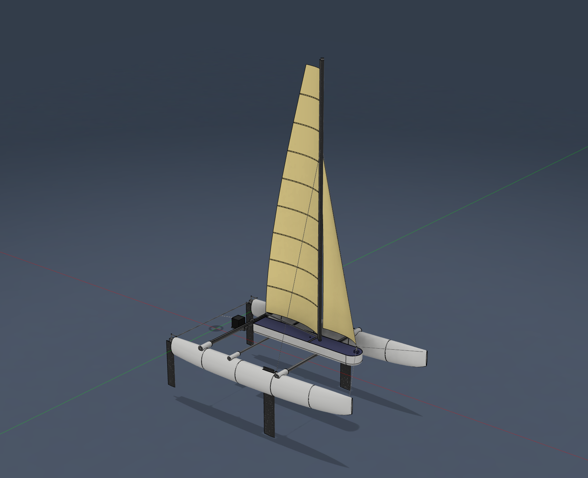

# RC Foiling Catamaran

A 1 m radio-controlled beach catamaran (Hobie 16 / Nacra 17 style) designed in Autodesk Fusion through its API, with its own velocity prediction program (VPP), stability and controllability analyses, and a simplified 0.6 m version to build first.

## Start here

| Document | What it is |
|---|---|
| [`poster/RC_Catamaran_Poster.pdf`](poster/RC_Catamaran_Poster.pdf) | A0 landscape research poster (scales to 48 x 36 in) |
| [`paper/RC_Catamaran_Paper.pdf`](paper/RC_Catamaran_Paper.pdf) | 10-page technical paper: design, methods (including the flying trim in heave and pitch), validation, results, stability and pitchpole, rig and crossbeam loads, ride-height design, foil design with the flight simulator (why v2.1 was withdrawn, v2.2), design iterations |
| [`mini/manual/RC_Mini_Cat_Build_Manual.pdf`](mini/manual/RC_Mini_Cat_Build_Manual.pdf) | Build manual for the 0.6 m Mini Cat: costed parts list, print settings, 10 build steps, radio setup, cost appendices for the 1 m boat and the foil kit |
| [`sim/foil_sim.html`](sim/foil_sim.html) | Foil flight simulator (open in a browser): wind speed and angle, sail trim, editable part weights, foil span, chord and incidence, elevator height, flaps on/off; shows flight mode, take-off speed and the top of the flying range, cruising speed, wind needed to fly, the flying attitude (pitch, elevator depth, rudder immersion), an acceleration run, a speed polar and a foil-size heatmap. Uses the VPP physics, including the flying trim in heave and pitch, and reproduces its speeds |
| [`mini/BUILD_LIST.md`](mini/BUILD_LIST.md) | Mini Cat shopping and build checklist: every part link re-checked on 2026-09-24 (verified / substituted / not re-verified), print list with STL names, 9-step build checklist |
| [`mini/manual/sail_patterns_1to1.pdf`](mini/manual/sail_patterns_1to1.pdf) | 1:1 main and jib patterns for the Mini Cat (with a 100 mm scale check) |

All four documents are regenerated from the analysis results by `mini/manual/build_manual.py`, `paper/build_paper.py` and `poster/build_poster.py` (LaTeX, compiled with tectonic). Edit the generators, not the `.tex` files.

## The three boats (Fusion hub "Project Hydrofoil" > Default Project)

| Fusion design | What it is | Parts cost | Status |
|---|---|---|---|
| **RC Mini Cat 600 (simplified)** | 600 mm, 2 radio channels (rudder + one winch driving both sheets on a stepped drum), round mast, 3-batten main | **$257.37** | Build first |
| **RC Catamaran v1.2 - Build First (rudders + daggerboards, no foils)** (latest version: v1.3 hulls, v1.4 pod) | 1 m, beach-cat rig with 3 sail controls, daggerboards | **$381.02** | Build second |
| **RC Foiling Catamaran v1** (latest version: v1.3 hulls, v1.4 pod, v2.2 foils) | 1 m + L-foils, T-foil rudders on 13 mm longer foiling rudders, wand-driven flaps for ride-height control | foil kit **+$101.17** | Design stage |

Prices were read on retailer pages on 2026-09-23, and every mini part link was re-checked on 2026-09-24 (the rigging line was replaced after its listing ended; see [`mini/BUILD_LIST.md`](mini/BUILD_LIST.md)); sources and CSVs are in [`bom/`](bom/). Shipping, tax, a NiMH charger, the printer, hand tools, screws and zip ties are not included. On the 1 m boat the traveler and jib tracks and cars are printed, and the line turning pins, gooseneck pin and boom eye are cut from the listed music wire. The FS-i6X radio and the 4xAA pack bought for the mini carry over to the 1 m boat.

## Key results (model predictions, not yet measured on the water)

| | Mini Cat 600 | 1 m build-first | 1 m foiling |
|---|---|---|---|
| Sailing mass | 755 g | 2037 g | 2242 g |
| Sail area | 0.144 m2 | 0.401 m2 | 0.401 m2 |
| One hull's buoyancy / boat weight (my design target: 2 or more) | 2.05 | 2.74 | 2.49 |
| Speed, beam reach, 8 kn of wind | 2.13 m/s | 2.67 m/s | 3.83 m/s (flying) |
| Top speed before the bows limit it | 2.13 m/s | 2.97 m/s | n/a (flying) |
| Max rudder angle needed (4-14 kn) | 1.6 deg of 19.9 deg | 2.6 deg of 18 deg | 4.4 deg while flying (4.7 deg at most to hold the largest side force anywhere in the flying range) |
| Max righting moment (heeled-hull calculation) / capsize angle | 1.20 N m / about 80 deg | 5.41 N m / about 80 deg | 6.00 N m / about 90 deg |
| Bow-down moment the hulls can resist (1 hull / 2 hulls) | 0.58 / 0.82 N m | 3.64 / 4.77 N m | 3.71 / 5.19 N m |
| Wind where the bows start to limit sailing (TWA 60/90/120/150) | 7.5 / 8.5 / 10 / 13.5 kn | none up to 20 / 9 / 11.5 / 16 kn | |
| Take-off | n/a | n/a | 1.99 m/s, from 7.06 kn on a beam reach and 7.53 kn at 60 deg (VPP); 6.75-8.75 kn in the sensitivity study |
| Heave (height) stability | n/a | n/a | fixed foils: none. With wand-driven flaps: damping ratio 1.36, 2.1-5.3 Hz, at most 13.2 deg of flap from take-off to the 12 kn speed |
| Flying trim (pitch, depths; `analysis/pitch_trim.py`) | n/a | n/a | flies from take-off to at least 6 m/s at +0.0 to +0.4 deg of pitch; up to the 12 kn speed the elevators stay at least 1.57 chords deep and 47 mm of rudder stays in the water |
| Heave and pitch together (`analysis/pitch_heave.py`) | n/a | n/a | stable across the flying range: one oscillating mode at 1.8-7.0 Hz, damping ratio at least 0.64 (0.62 with elevator efficiency 0.65); pitch inertia 0.207 kg m2 from the CAD |
| Mast buckling safety, sheet servo at stall (sailing loads only) | 2.4 (10.9) | 3.6 (15.6) | 3.5 (13.9) |
| Crossbeam bending safety, sheet servo at stall (assumed 300 MPa strength) | 5.6 | 3.0 | 2.9 |
| Foil stability and sizing test (`analysis/foil_checks.py`) | n/a | n/a | 28 of 28 pass: pitch static margin 32-84 mm; coupled heave-pitch modes stable (least damping ratio 0.64); a 20 mm height disturbance settles in 0.22-0.54 s with no overshoot |

## Design iterations driven by the analysis

1. **Foil depth:** the main foils were raised to the elevator depth. This saved 73 g of carbon at no cost in ride height.
2. **Mini hull sections:** scaled 0.68 instead of 0.65, because the electronics don't shrink with the boat.
3. **Stepped winch drum:** a 16.2 mm jib groove, so both sheets reach full ease in the same 1.63 turns.
4. **Winch fit:** the 3.5-turn winches first chosen (50 mm tall) did not fit the 48.8 mm pod. They were replaced by 45 g standard-size winches after a torque check, saving about 130 g and $92.
5. **Bow volume (v1.3 hulls):** +23 % one-hull pitchpole margin for +0.4 % drag and +13 g (`analysis/hull_variants.py`).
6. **Pitch-limited depowering in the VPP:** the model now picks the better of sailing flat on both hulls or flying a hull, as a skipper would.
7. **Servo fit (v1.4):** every mount was checked against the manufacturers' drawings (Feetech FS5115M spec sheet, Tower Pro MG90S drawing, JX case size from a retailer listing). Three misfits were fixed:
   - The 40.5 mm winch cases did not fit between rails 40.2 mm apart (40 mm on the mini).
   - The 1 m rails were 3.5 mm below the FS5115M ears.
   - The mini's MG90S rails were 6 mm below its ear line.

   The rails now have 0.3-0.4 mm clearance and a wire notch each. The winches hang in 4-6 mm wells, so their drums clear the lid by 5.6-7.9 mm (was 0.4 mm on the mini). Script: `cad_scripts/servo_mounts.py`.
8. **Rig clearance (v1.4 pod):** a sweep of the Fusion model over nine trims (`cad_scripts/clearance.py`) found three problems with the pod, which then ran over both beams:
   - It blocked the traveler car for boom angles below about 7.5 deg.
   - In that range, the mainsheet from the clew down to the car passed through the lid.
   - The jib car sat inside the pod.

   The fixes:
   - The pod now ends in a transom 11 mm forward of the clew.
   - A light third crossbeam (10 x 8 mm carbon, cut from the mast-joiner tube already in the parts list) carries the pod's aft end at x = 350 mm, where no mainsheet position reaches. A first version hung the pod on a cradle under the rear beam; a load check showed a cradle under a beam cannot hold anything up, so it was replaced.
   - The rudder servo sits aft of the rear beam on a printed bracket that clamps the beam from below (240 deg, open over the top), under a printed cover, so the car can cross the centreline.
   - The same interference check found the tiller arms and ride-height wands rubbing the hulls (both boats' tillers, the 1 m wands). The arms are now level and clear the decks, and the wands hinge ahead of the stems.
   - The jib track moved onto the pod lid.

   All nine trims (0/5 to 40/40 deg) are now clear. Script: `cad_scripts/pod_v14.py`.

9. **Mini crossbeams (structure check):** with the sheet winch at stall, the mini's first 8 x 7 mm beams (0.5 mm wall) reached a bending safety factor of about 2 against an assumed 300 MPa. They are now 10 x 8 mm tube, $1.05 cheaper, for 18 g more (`analysis/structure.py`).
10. **Foil sizes, first pass (v2.1):** a first flight-simulator search, with each foil pair carrying a fixed share of the weight at level attitude, picked smaller foils with 4 deg elevators (wing 160 x 40 mm at 0 deg, elevators 140 x 32 mm at 4 deg). They were drawn in CAD.
11. **Pitch trim (v2.2 foils, `analysis/pitch_trim.py`, `sim/optimize.js`):** adding the trim in heave and pitch withdrew v2.1.
    - The sail drive's bow-down couple makes the elevators push down at speed.
    - Elevators fixed at a positive incidence can only do that by pitching the boat nose-down. The stern, a metre behind the bow wand, then lifts them out of the water. Neither v2.0 nor v2.1 has any speed with a feasible trim.
    - The search was repeated with the trim, the elevator height as a variable, a 30 mm pitch static-margin limit, a steering check, operating margins at 12 kn and robustness checks (couple x0.5 / x1.5, CG +-20 mm).
    - **Adopted v2.2:** wing 160 x 45 mm at +1.5 deg, elevators 120 x 28 mm at -1 deg, lowered 13 mm on longer foiling rudders (printed extensions). It flies level from 7.06 kn on a beam reach (VPP) and does 4.65 m/s in 12 kn.
    - The v2.1 sizes cannot be rescued: once the elevators push down, the 40 mm wing bends past the 2 mm limit.
12. **Fittings and masses (`cad_scripts/rig_fittings.py`, `cad_scripts/linkage.py`):** the placeholder blocks were replaced by printable parts:
    - Gudgeons.
    - T-rail traveler and jib tracks with sliding cars (the add-in still moves the cars).
    - A hounds collar the stays tie round, so the mast turns inside their loop.
    - A mast cap that seals the tube, and a bridle post.
    - A gooseneck and boom jaw.
    - The ride-height linkage: 8.25 mm wand horn, 8 mm bellcrank, 5.5 mm flap horn, giving 1.5 deg of flap per deg of wand.
    - The wing-mast fairing, as 0.45 mm vase-mode shells in seven pieces, with the main's luff laced to its trailing edge.

    A clearance sweep with the gooseneck turning with the wing and the boom end with the boom moved the fork from the boom end to the gooseneck: a boom-end fork reaching below the boom would hit the jib car with the main eased and the jib sheeted in. The same sweep found that with the jib sheeted fully in (5 deg) and the main eased past about 31 deg, the jib sheet crosses the boom itself; the manual says to ease the jib first.

    Two assumed masses were wrong:
    - The fairing, gooseneck and boom jaw weigh 45.0 g, where 10 g had been assumed.
    - The rudder stocks, tiller arms, tie bar and pushrod are music wire but had been weighed as aluminium. The steel tie bar alone is 56 g.

    The build-first boat went from 2037 g to 2114 g and the foiling boat from 2242 g to 2332 g, with the CG about 7 mm further aft. The traveler's end stops limit the boom to about 35 deg.

## Repository map

| Path | Contents |
|---|---|
| `analysis/vpp.py` | VPP: ITTC-57 friction, Michell thin-ship wave resistance with catamaran interference (Filon-type panel integration; tabulated over hull load and speed in `hull_table()` and interpolated exactly as the simulator does), appendage and foil drag, sail model depowered for heel and for pitch. Configurable hull (`vpp.configure`) |
| `analysis/stability.py`, `pitchpole.py` | Heel (GZ) curves from the heeled hull sections; the largest bow-down moment the hulls resist; pitchpole wind limits |
| `analysis/hull_variants.py` | Bow-volume study behind the v1.3 hulls |
| `analysis/control.py` | Rudder authority (yaw balance), foil pitch neutral point, heave check |
| `analysis/ride_height.py` | Wand-flap sizing: flap, pitch and bow height across the flying range, heave stiffness and damping |
| `analysis/pitch_heave.py` | Coupled heave-pitch stability (2 degrees of freedom, linear) across the flying range, with the pitch inertia from `analysis/cad_inertia.json` (`cad_scripts/export_inertia.py`) |
| `analysis/pitch_trim.py` | Flying trim in heave and pitch (sail-drive couple, elevators, wand) for v2.0, v2.1 and the CAD foils, plus robustness cases |
| `analysis/sensitivity.py` | Take-off sensitivity to sail lift, foil lift and mass |
| `analysis/run_all.sh`, `run_vpp_chain.sh` | Pipelines that rerun everything in order |
| `analysis/structure.py` | Rig and crossbeam loads: shroud and forestay tension, mast compression and Euler buckling, crossbeam bending, with the sheet servos at stall as the worst case |
| `sim/sim_core.js`, `sim/optimize.js` | Simulator physics shared by the page and the batch optimizer; the optimizer writes `sim/optimization_results.json` and the paper's Fig. 9 / Table 7 data |
| `sim/export_sim_data.py`, `sim/build_sim.py` | Rebuild the simulator after a design change: export the hull wave-resistance table from the VPP, then inline it into `foil_sim.html` |
| `analysis/foil_checks.py` | Foil stability and sizing test: pitch margin, heave with fixed foils and with wand flaps (plus a time-domain run), take-off, lift coefficients, submergence, root stress |
| `analysis/design_checks.py` | Design-rule check run at the end of `run_all.sh`: buoyancy reserve, rudder and pitch margins, heave damping, take-off wind, rig-to-pod clearances, servo fit, drum-to-lid gap (`design_checks.json`) |
| `analysis/figures_data.py` | Plot data for the paper and poster |
| `mini/mini_analysis.py`, `mini/manual_data.py` | Mini hydrostatics, VPP, rudder check; rigging lengths, drum sizing, sail patterns |
| `bom/make_bom.py` | Costed parts lists with source URLs (mini, 1 m build-first, v2 foil kit) |
| `cad_scripts/` | Fusion API scripts: `build_mini.py`, `build_full_hull.py` (v1.3 hulls + print segments), `servo_mounts.py` (rails and wells from the servo drawings), `pod_v14.py` (shortened pod, pod-beam saddle, rudder-servo bracket and cover), `foils_v21.py` and `foils_v22.py` (foil sets with flaps and pushrod channels; v2.2 adds the rudder extensions), `elevator_trim.py` (elevator trim pods), `foil_cores.py` (printable cores with carbon-cap recesses), `linkage.py` (ride-height linkage), `rig_fittings.py` (gudgeons, tracks, bridle post, mast cap, hounds collar, mast fairing, gooseneck, boom jaw; STLs and print list), `clearance.py` (rig-to-pod sweep), `export_mini_mass.py`, `export_full_mass.py`, `export_inertia.py` (pitch and roll inertia for the heave-pitch check) |
| `cad/`, `stl/`, `mini/cad/`, `mini/stl/` | STEP / Fusion archives and print-ready STLs |
| Sail Trim add-in | `~/Library/Application Support/Autodesk/Autodesk Fusion 360/API/AddIns/SailTrim/` (`rig_model.py`, `fusion_rig.py`, `fittings_geom.py` for the printed cars, `SailTrim.py`); copy in `fusion_addin/SailTrim/` |

Current exports: `cad/RC_Catamaran_v1.4_Build_First_no_foils.step/.f3d`, `cad/RC_Foiling_Catamaran_v2.2.step/.f3d`, `cad/Foiling_Kit_v2.2_carbon_parts_flaps_rudder_extensions.step` (the v2.1 exports are kept for reference). The 1 m print parts are in `stl/`: v1.3 hulls, the v1.4 pod and lid segments, `Rudder_Servo_Bracket.stl`, `Rudder_Servo_Cover.stl`, the fittings (`Gudgeon_x2`, `Traveler_Track_Centre/Port/Stbd`, `Traveler_Car`, `Jib_Track`, `Jib_Car`, `Bridle_Post`, `Mast_Cap`, `Hounds_Collar`, `Mast_Fairing_Lower_x5`, `Mast_Fairing_Upper_x2`, `Gooseneck`, `Boom_Jaw`) and, for the foiling version, the foil cores, flaps, trim pods, rudder extensions and linkage parts (`Wand_Hinge_Bracket_x2`, `Wand_Hub_x2`, `Bellcrank_Mount_x2`, `Strut_Bellcrank_x2`, `Flap_Horn_x2`). The full print list with sizes and filament is in the 1 m manual. The mini's print parts are in `mini/stl/`.

## Sail Trim add-in

In Fusion: UTILITIES > ADD-INS > Scripts and Add-Ins > Add-Ins tab > **SailTrim** > Run (set to run on startup). Then UTILITIES > ADD-INS > **Sail Trim**.

- On the 1 m boats it shows three sliders:
  - **Front sail (jib sheet):** jib angle
  - **Back sail (main traveler):** boom angle, traveler car and mast rotation
  - **Back sail tension (mainsheet):** twist and depth of the main
- On the mini it shows one slider: both sails on one winch.

The geometry update behind the dialog was tested through the API, but the dialog itself has not yet been opened by hand.

## Validation done so far

- Hull volume from the station table vs the CAD loft (v1.3 hulls): -0.20 %.
- Design-rule check (`analysis/design_checks.py`): 26 of 26 rules pass.
- Foil stability and sizing test (`analysis/foil_checks.py`): 28 of 28 pass, including a time-domain heave simulation and the flying-trim checks (depths, rudder immersion, steering, flying range with the pitch couple halved or 1.5x).
- Michell integral: grid-converged to 0.03 % on the Wigley hull, with the expected hump/hollow shape. Thin-ship theory is reported to over-predict near the main hump, so wave drag is on the pessimistic side.
- Heeled-hull maximum righting moment vs the W x s/2 used by the VPP: within 3.3 % (1 m) and 4.7 % (mini).
- Regression test after refactoring `vpp.py`: resistance values identical to 5 significant figures.

## Main assumptions

- Hull form factor 1.25
- Sails: CL max 1.3, CD0 0.05, depowered to at most 90 % of the heel and bow limits
- Foils: thin-airfoil theory with a lifting-line slope (e = 0.85); flap effectiveness 0.8 x thin-airfoil value; usable CL 0.8; unidirectional carbon cap laminate E about 120 GPa (assumed)
- Flying trim: sail drive equals the flying drag, acting at the sail centre of effort; limits of half a chord of submergence, 30 mm of rudder, 80 % of the rudder throw for steering and a 30 mm pitch static margin (elevator efficiency 0.65) are assumed
- Rudders: CL max 0.8
- Loads: the mainsheet runs twice between the traveler car and the boom, so at servo stall the boom, car and rear beam carry twice the tail tension; the tail is on the servo horn 25 mm from the shaft (15 mm failed the factor-of-2 rule). Printed PETG in bending: 25 MPa (assumed).
- Masses: PETG 1.27 g/cm3, carbon 1.55 g/cm3 and music wire 7.85 g/cm3. The mast fairing is weighed as printed: 0.45 mm shells. Servo, receiver and battery weights are from manufacturer specs. The exception is the JX W4505-2T winch, taken as 45 g: the weight listed for JX's 1.5-turn and 4-turn standard winches.

## Build notes for the 1 m boat

- **Pod beam:** cut a 600 mm length from the 10 x 8 mm carbon tube (the mast joiner uses 150 mm of it) and epoxy it into the third socket in each hull. The pod snaps onto it and onto the front beam.
- **Rudder servo bracket:** snap the bracket's clamp onto the rear beam from below, centred between the hulls, and epoxy it there so it cannot rotate. Its clamp stays under the traveler track.
- **Rudder servo:** the MG90S hangs by its ears on the bracket's rails, aft of the beam, under the printed cover. The pushrod leaves through the slot in the back of the cover and runs to the tie bar.
- **Control lines:** the two ends of the traveler line and the mainsheet tail leave the pod through the three holes in the transom and run aft to the 0.093 in wire turning pins in the traveler track's end stops.
- **Mainsheet routing:** the traveler car moves up to 213 mm either side of the centre line, far more line than the mainsheet servo can take up, so route the mainsheet so the car cannot pull on it:
  1. Tie the mainsheet to the port end-stop pin (upper slot).
  2. Run it through the car's port post, up through the eye under the boom and back down.
  3. Lead it through the starboard post, round the starboard pin (upper slot) and forward into the pod.
  The traveler line is one loop from the winch drum, round both pins (lower slots) and through the car, fixed to the car with CA.

  Moving the car then shortens one side of the sheet exactly as much as it lengthens the other, so the traveler does not change mainsheet tension, which is how the trim model treats it.
- **Winch ears:** JX does not publish the winch's ear height, so the rails use the FS5115M value (27.3 mm above the case bottom). If a winch case touches the bottom of its well before the ears reach the rails, shim under the ears.
- Hull STLs are real 0.8 mm skins. Slice with 2 perimeters and 0 % infill. Each print segment is a sealed compartment ending in half of a bulkhead; epoxy the segments face to face.

## Next steps

1. Build and GPS-log the Mini Cat, then compare with its VPP table (manual Appendix A).
2. Build the 1 m build-first boat.
3. Make the carbon-capped v2.2 L-foils with flaps and the longer foiling rudders (elevator incidence adjustable by at least +-1 deg), tow-test them, tune the wand gearing, then fly.
